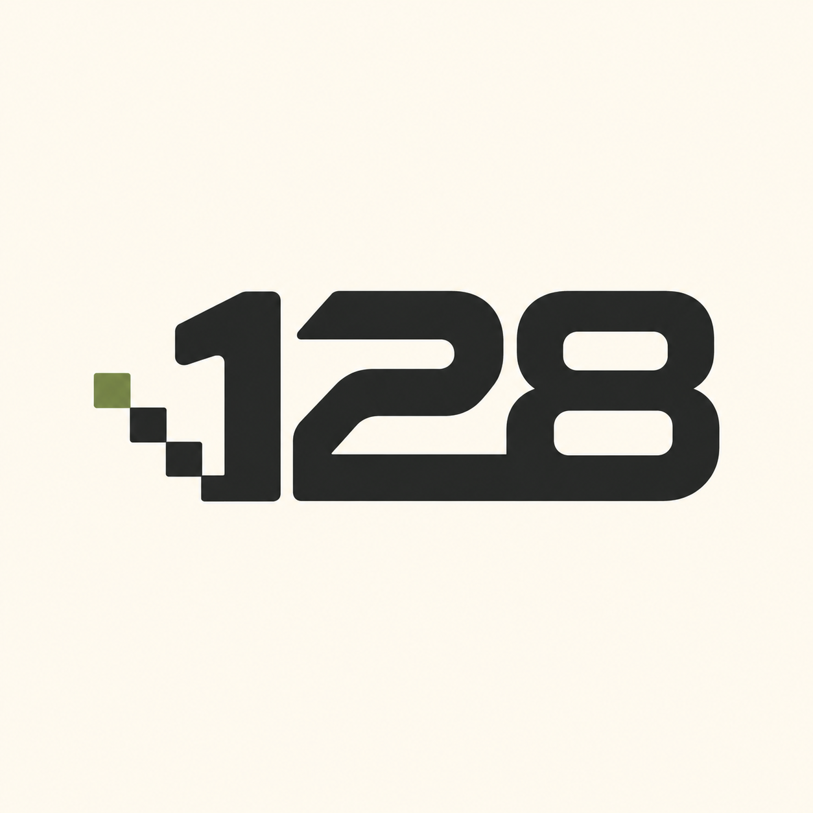

# HD Texture Pack & Improvements for JediJosh’s PC Port

**Revenge of the Sith · by The128ReBits**

**Native Windows port by [JediJosh](https://github.com/jedijosh920/SWROTS-PC). HD texture pack and added improvements by The128ReBits.**

[Español](README_ES.md) · [Free download](../../releases/latest) · [Installation guide](GUIDE_EN.txt) · [Full credits](CREDITS_EN.txt) · [Complete feature catalogue](FEATURES.md)

Return to the Xbox game on PC with **2,338 HD textures, five text languages, revised playable characters, controller character selection from pause for P1/P2, expanded co-op options and my own configurator and installer**.

## What The128ReBits adds

| Area | Included in this pack |
|---|---|
| HD textures | 2,338 adapted DDS textures, toggleable, at the original resolution of my HD pack; partial coverage |
| **Multilingual game** | **Spanish, English, French, German and Italian subtitles, menus and game text**, alongside translated character entries, installer, configurator and credits. Added over the English-language v0.4.0 base. **Voices remain in English.** |
| PAL and USA | Separate regional cores and automatic selection for recognised Xbox discs |
| Characters | 40 rated entries covering characters, classes and variants; revised controls and native actions, notes, outfits and recommended weapons |
| Weapons | Automatic, Saber, Blaster or Native profiles, with per-character style and damage settings |
| In-game selection | Controller-friendly character selection from the pause menu for P1 and P2; per-level character cache |
| Gameplay | Faithful and Madness modes, per-character challenges, balanced health/damage/defence and mission help |
| Co-op additions | Character selection and profiles, balanced health and P2 shield, building on JediJosh’s existing two-player co-op |
| Configurator | Separate window for graphics, HD, modes, characters, weapons, P2 and language; keyboard/mouse editor, side buttons, multiple bindings and duplicate warnings |
| Utilities | Named settings/control profiles, save backups/restoration, installation checks, bug reports, folder access and launch preferences |
| Installer | Add to a working port or prepare a fresh installation from your port ZIP/folder and own Xbox ISO; progress, regional checks and backups |

Revised native actions include the super battle droid, buzz droid, flyer, walker, flamethrower, droideka, B1/clones, grappler, R2-D2 and C-3PO. Palpatine is one of the playable adaptations, including P2. These are adaptations of the game’s own resources and actions. Functionality differs by entry; read its rating and notes.

## JediJosh made the foundation

JediJosh created **JediJosh’s PC port**, the native Windows port: graphics and sound, higher internal resolution, widescreen, keyboard/mouse and Xbox/PlayStation controllers. His work also adds Yoda and Sith Yoda in Versus, character/body selection and loading from other levels, duel moves, the original two-player story co-op, free camera, debug/modding tools, loose-file replacements and port fixes.

**Thank you, JediJosh, for bringing the game to PC and sharing your code, research and tools.** [Original project](https://github.com/jedijosh920/SWROTS-PC) · [Support JediJosh](https://ko-fi.com/jedijosh920)

## Download and install

Open [Releases](../../releases/latest) and download **Pack_Texturas_HD_y_mejoras_by_The128ReBits_PAL-USA_SWROTS-PC_v0.4.0.zip**. The automatic “Source code” archives are not the player installer.

You need **[JediJosh’s PC port v0.4.0](https://github.com/jedijosh920/SWROTS-PC/releases/tag/v0.4.0)**, your **own recognised PAL/USA Xbox game**, and Windows compatible with the port. The game, ISO and original port files are not included. This is the native JediJosh’s PC port edition; the PS2/PCSX2 pack is a separate download and is not required.

Extract the **complete ZIP** and open **Instalar Pack HD y mejoras.exe**.

1. **Already working:** choose the first option and select your installed game folder. The installer backs up replaced files and preserves your executable, game data, saves and settings.
2. **Fresh installation:** choose the second option, provide JediJosh’s v0.4.0 port ZIP/extracted folder and your supported Xbox ISO/XISO, then choose a new or empty destination. HD is included.

Open the configurator afterwards to choose language, mode and preferences. The installer does not automatically start the game. Optional third-party graphics downloads are managed by the assistant; DLSS is not required for HD.

## Compatibility and known issues

**30 FPS is recommended for story play. Higher settings are experimental.** Support targets v0.4.0 and recognised PAL/USA revisions. Another port version may be replaced with the mod’s v0.4.0-based core after a warning and backup; later port features are not automatically retained.

HD coverage is partial and texture resolutions vary. The 40 entries are characters/classes/variants, with different functionality ratings. Known pending issues include the droideka bubble, flamethrower grab damage and walker charge/aiming. External portrait BMPs have been removed; disc-resource fallback is retained where available, and its presentation needs in-game review. Co-op uses JediJosh’s shared camera; no online mode is added.

## Source, checks and credits

The release includes a **corresponding-source ZIP**, regional PAL/USA source trees, installer/configurator source and build scripts. The player archive also includes the sources. [Binary/source map](SOURCE-MAP.json) · [Checksums](SHA256SUMS.txt) · [Changes](CHANGES_EN.txt) · [Licence map](LICENSE_MAP.md).

Base: upstream v0.4.0 commit `f459f126fd9a62065fa1764d7127469900a6e653`. Installer/configurator compilation, manifest/ZIP checks and pinned download integrity checks passed. This distribution revision has not received a new gameplay/GPU test; regional core rebuilds were not repeated during packaging. See the source map for the recorded build provenance.

Original game by **The Collective and LucasArts**. Original game resources and trademarks retain their respective owners. Port and modified code retain their GPL notices; third-party components retain their own terms. Optional graphics technologies are credited to their authors.

For bugs, use **Configurator → Utilities → Create bug report**, review it, and include region, mission, character and reproduction steps in [Issues](../../issues).

The finished pack is **free**. Optional support: [Ko-fi](https://ko-fi.com/the128rebits) · [Patreon](https://www.patreon.com/The128ReBits) · [All links](https://linktr.ee/the128rebits).
